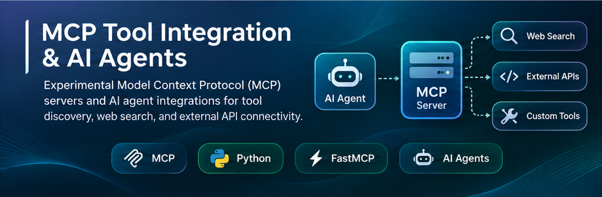
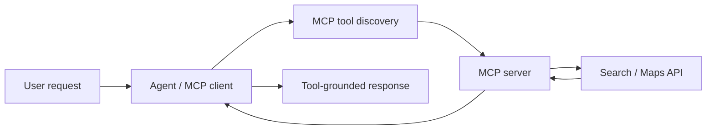

# MCP Server Experiments — Search & Recommendation Tools




A collection of Model Context Protocol (MCP) server and agent experiments. The supplied source includes FastMCP servers, client/agent examples, HTTP server experiments, and tool integrations for web search and restaurant/food recommendations.

> This repository is an experimental collection rather than a single polished service. Some examples use external search, LLM, or maps APIs and require separately configured credentials.

## Included experiments

- FastMCP server examples.
- MCP client and agent examples.
- React-style agent experiments.
- HTTP transport/server examples.
- Web-search integration examples.
- Restaurant and food recommendation tools using location/search APIs.
- Small JSON fixtures used by selected experiments.

## Conceptual architecture



## Repository layout

```text
.
├── client*.py
├── Client_agent.py
├── experiment.py
├── info_server*.py
├── react_agent.py
├── recommend*.py
├── recomendationAgent*.py
├── server*.py
├── restaurent.py
├── landing.html
├── settings.json
├── *.json
└── README.md
```

## Requirements

The experiments use Python and may require:
- `mcp`
- `requests`
- `uvicorn`
- `openai`
- `langchain` / `langchain-community`
- Google Places or Serper API access, depending on the script

Install the packages required by the specific experiment you want to run. The original archive did not include a single consistent dependency manifest for this folder.

## Configuration

Set credentials through environment variables, for example:

```bash
# macOS / Linux
export OPENAI_API_KEY="..."
export SERPER_API_KEY="..."
export GOOGLE_PLACES_API_KEY="..."

# Windows PowerShell
$env:OPENAI_API_KEY="..."
$env:SERPER_API_KEY="..."
$env:GOOGLE_PLACES_API_KEY="..."
```

Never place real credentials in source code, JSON files, screenshots, or commits. Use restricted API keys and rotate any key that may previously have been exposed.

## Running an experiment

Choose the relevant script and inspect its imports, tool definitions, and transport configuration. For example, a FastMCP server may be started with:

```bash
python server.py
```

The available scripts are not all interchangeable; some are clients, some are servers, and some are standalone experiments. Follow the entry point and transport expected by the selected client.

## Security

- Validate tool inputs and constrain outbound network requests.
- Do not expose unrestricted location, search, or external API tools.
- Keep secrets in environment variables.
- Review tool output before passing it into an agent.
- Treat retrieved web content as untrusted data.

## Project status

This is a cleaned snapshot of experimental code. It is not presented as a hardened MCP deployment, and individual scripts may require dependency, API, or transport adjustments.

## License

Add a license only after confirming you have permission to publish the source and included assets.
